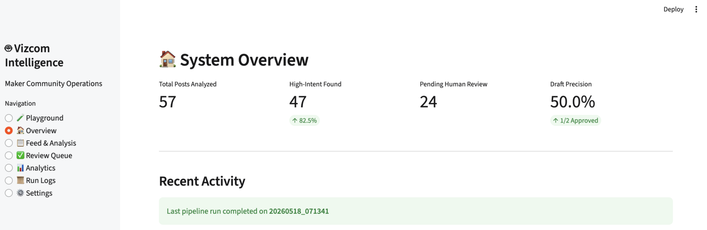
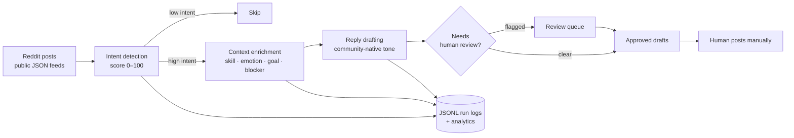
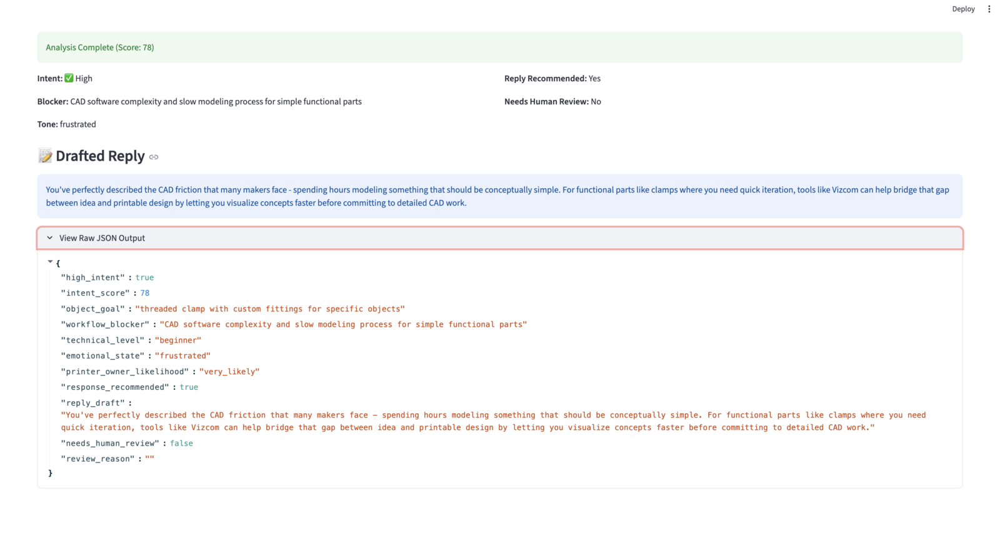
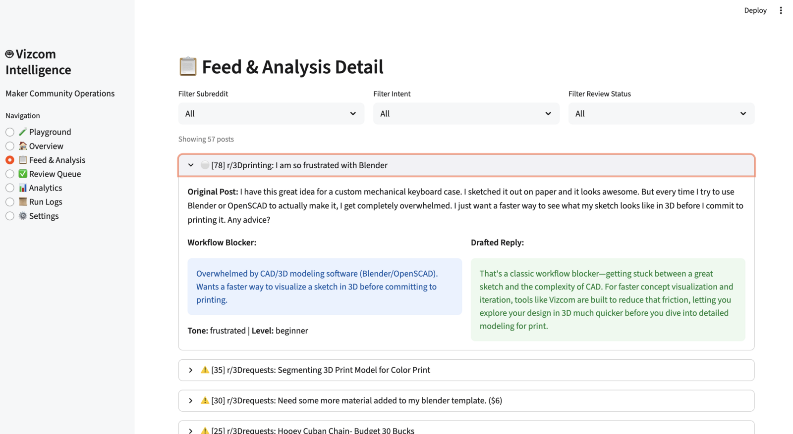
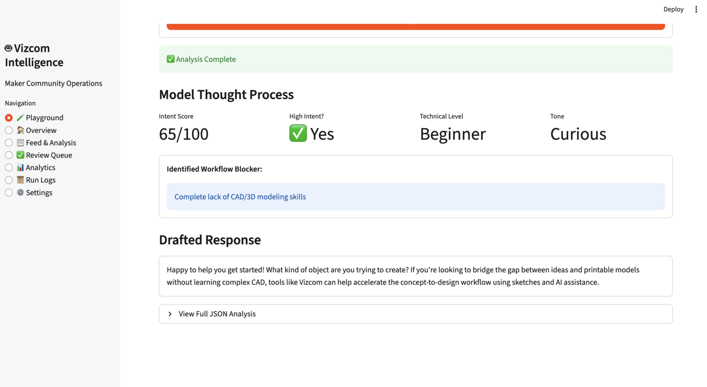
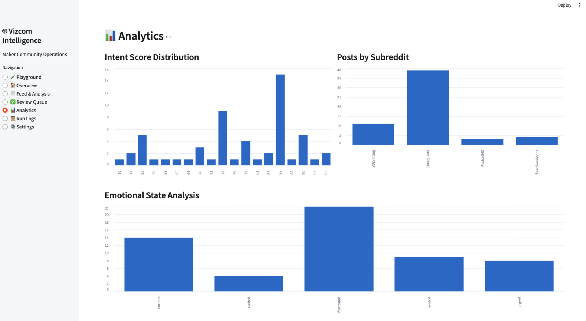
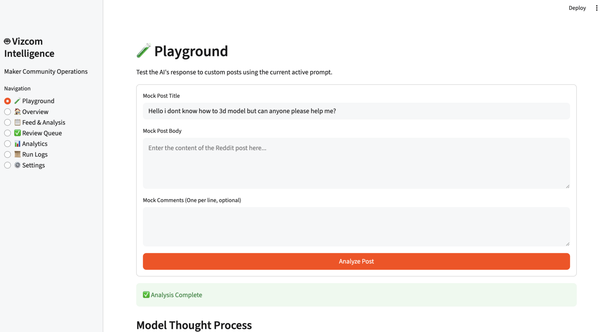

# Vizcom Maker Intelligence: An Agentic GTM System

An AI system that finds makers on Reddit who are stuck between an idea and a printable object, works out what's blocking them, and drafts helpful, community-native replies for a human to review before anything is posted.

I built it as a go-to-market concept for [Vizcom](https://www.vizcom.ai), an AI design tool that turns sketches into editable visual concepts.



| 57 | 47 | 24 | 3 |
|:---:|:---:|:---:|:---:|
| posts analyzed | flagged high-intent (82%) | routed to human review | stages before a human sees anything |

## The insight

Most people don't want to learn CAD. They want an outcome: a printable part, a customized STL, a prototype. Today the beginner's path looks like this:

```
Idea → learn CAD → learn printing constraints → learn modeling workflows → maybe succeed
```

These people are already describing that gap in public, in communities like r/3Dprinting, r/functionalprint, r/3Drequests, r/BambuLab, r/prusa3d, r/FixMyPrint, and r/printmything. They're telling you their skill level, their frustration, and exactly what they want to make. That's an unusually rich, high-intent signal for a tool whose whole pitch is "sketch to design, without the CAD wall."

## What the agent does



1. **Ingest:** fetch new posts from maker subreddits through Reddit's public JSON endpoints and normalize them into structured objects.
2. **Detect intent:** is this a real maker with a real project, or noise? The agent outputs an intent score and the specific workflow blocker.
3. **Enrich:** extract technical level, emotional state, object goal, and likelihood that the author owns a printer. This structured layer is reusable intelligence, not throwaway text.
4. **Draft a reply:** short, helpful, and written like an experienced maker, not a marketer, a chatbot, or a freelancer touting for work.
5. **Route for review:** flag posts with high uncertainty, sensitive or personal situations, competitor mentions, or commission requests.
6. **Log everything:** every run is written to JSONL for replay, debugging, and analytics.

## Example

**Post (r/3Dprinting):** *"Easiest and fastest way to create 3d models? Any alternatives to CAD software?"* The author is learning Fusion 360, finds it slow, and needs a custom threaded clamp they "could have drawn on paper in 30 seconds."



```json
{
  "high_intent": true,
  "intent_score": 78,
  "object_goal": "threaded clamp with custom fittings for specific objects",
  "workflow_blocker": "CAD software complexity and slow modeling process for simple functional parts",
  "technical_level": "beginner",
  "emotional_state": "frustrated",
  "printer_owner_likelihood": "very_likely",
  "response_recommended": true,
  "needs_human_review": false
}
```

**Knowing when *not* to reply matters just as much.** A post in r/3Drequests asking someone to split a model into parts for about $25 scored 35 and got **no draft at all**. That person wants to hire a human, not hear about a tool. More examples are in [`sample_outputs.json`](sample_outputs.json), and the full output contract is in [`analysis_output.schema.json`](analysis_output.schema.json).

## The dashboard

I built an operations console in Streamlit so the system stays inspectable rather than a black box.

| Feed & analysis | Analysis result |
|---|---|
|  |  |
| Every post with its score, blocker, tone, and draft, filterable by subreddit, intent, and review status. | Intent score, skill level, tone, the identified blocker, and the drafted response. |

| Analytics | Playground |
|---|---|
|  |  |
| Intent score distribution, posts by subreddit, emotional state breakdown. "Frustrated" is the most common state. | Paste any post and test the current prompt version before running it on live data. |

The console also has a review queue (approve / reject), run logs, and settings showing the active prompt version.

## Design decisions

**Human-in-the-loop, always.** The system never auto-posts. AI drafts, a human reviews, a human posts. This was a deliberate strategic choice, not a missing feature: automated brand replies in tight-knit maker communities risk spam flags, moderator bans, community backlash, and hallucinated advice. One bad post can cost more goodwill than a hundred good ones earn.

**Deterministic stages instead of autonomous agents.** I deliberately avoided multi-agent swarms, autonomous loops, memory systems, and vector databases. Each stage has a single job and a structured output, which makes the system easier to debug, observe, and control, and lets each prompt be versioned and tuned on its own.

**JSON/JSONL instead of a database.** At MVP scale, flat files make every run easy to inspect, replay, and diff. PostgreSQL can come when the data justifies it.

**Reddit first.** Users openly describe real problems in long-form posts, ask for help, and are honest about their frustration. No other free source gives such high-intent signal for this audience.

## Tech stack

| Layer | Technology |
|---|---|
| LLM provider | OpenRouter |
| Primary model | DeepSeek V3.1 Terminus |
| Language | Python |
| Dashboard | Streamlit |
| Storage | JSON + JSONL logs |
| Prompts | Versioned text files (v1 → v5) |
| Built with | AntiGravity (AI coding IDE) and ChatGPT for planning |

## What works and what doesn't yet

**Strong:** the structured workflow design, prompt versioning, enrichment quality, moderation logic, and operational visibility. It's especially good at spotting CAD frustration, customization intent, and how serious a maker is.

**Limitations:**
- **Draft precision is early.** In the review-queue sample, 1 of 2 reviewed drafts was approved. The review loop exists precisely because drafts still need a human eye.
- **No long-term memory.** History is stored, but there are no embeddings or semantic retrieval yet.
- **Reddit only, text only.** Many maker posts are image-first (sketches, photos of parts). Reading images is an obvious next step.
- **Analytics are basic.** Distributions are in place; trends and conversion tracking are not.

## Roadmap

1. **Feedback loops:** track human overrides, engagement outcomes, and which recommendations actually helped, then feed that back into the prompts.
2. **Semantic retrieval:** embed posts to cluster recurring frustrations and surface workflow trends across communities.
3. **Image understanding:** analyze sketches and part photos attached to posts.
4. **Cross-platform:** Discord, X, YouTube comments, and maker marketplaces.
5. **Richer analytics:** subreddit quality scoring, creator segmentation, workflow heatmaps.

## The real takeaway

The reply is only the visible surface. The real value is the intelligence layer underneath: a structured, continuously updated map of **who wants to make what, what's stopping them, and how they feel about it**. That's useful to GTM, to product (which blockers come up most?), and to positioning (what words do makers actually use?).

## Background

This project came out of a [VC evaluation of 15 AI startups](https://github.com/adapaabhi137/vc-evaluation-framework), where I ranked Vizcom #2 and chose it for deeper diligence.

## Source code

*Code is being cleaned up for public release.* The repo already includes a `.gitignore` and a `.env.example`, so API keys stay out of version control.

---

*Independent project. Not affiliated with or endorsed by Vizcom or Reddit. Example posts are paraphrased and shown without usernames.*
